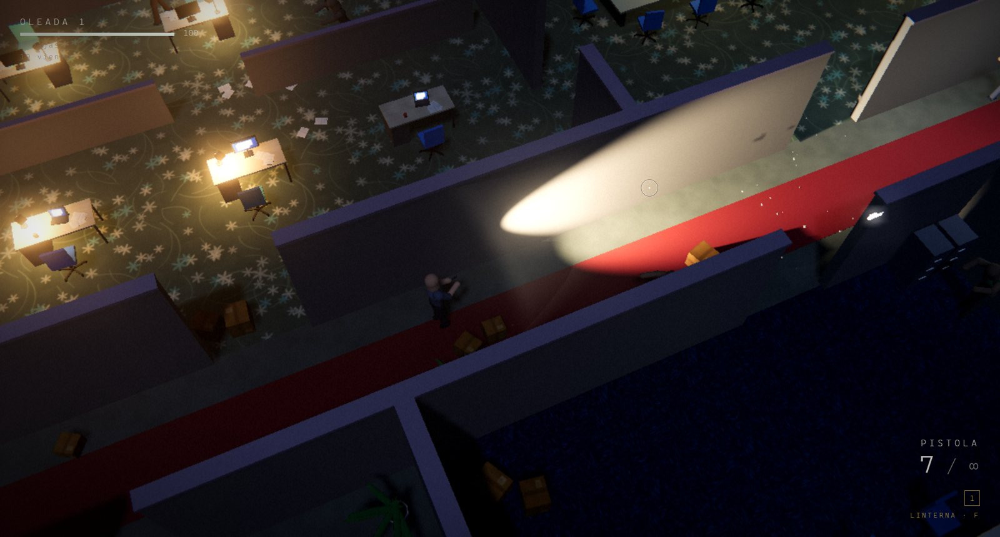
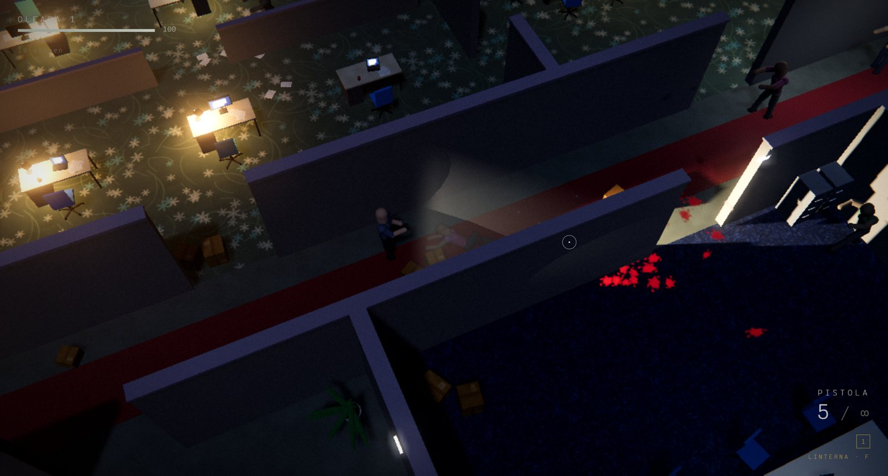
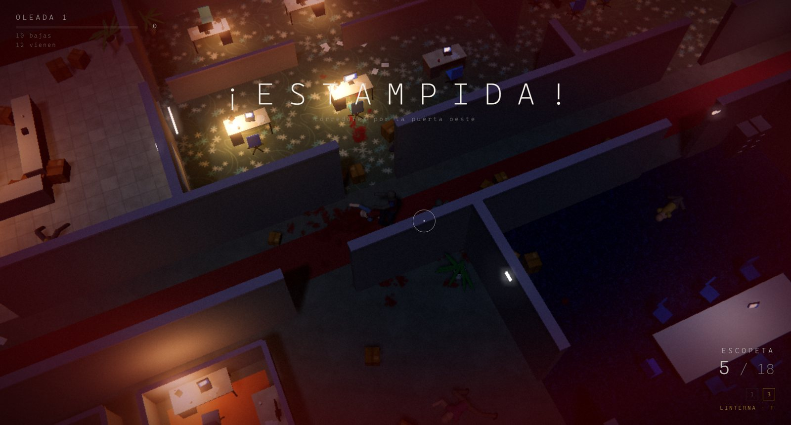
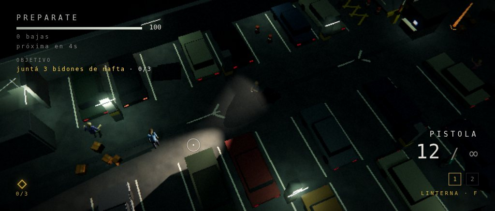
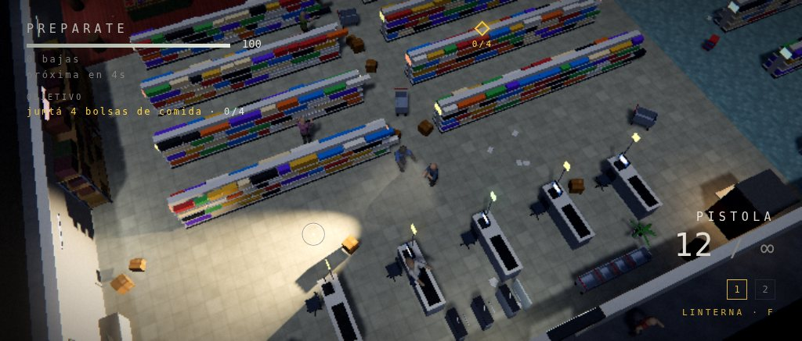
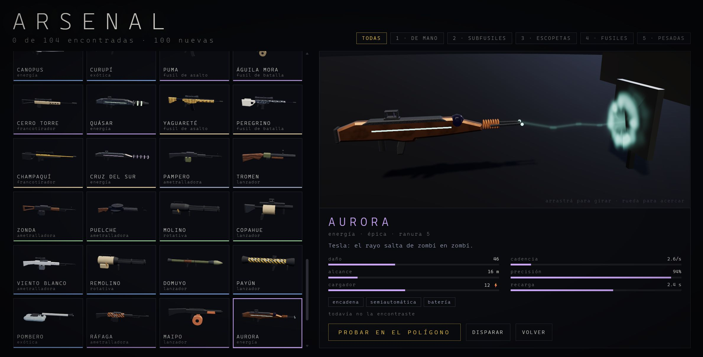
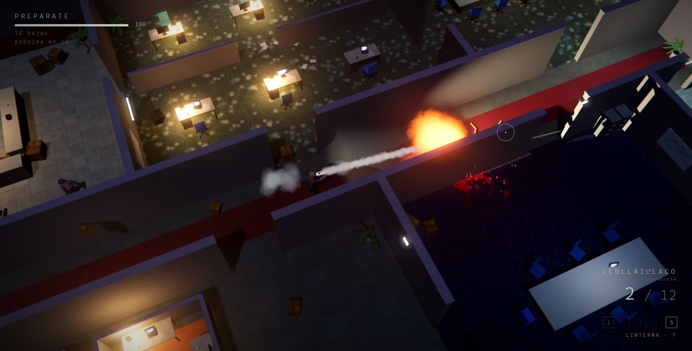
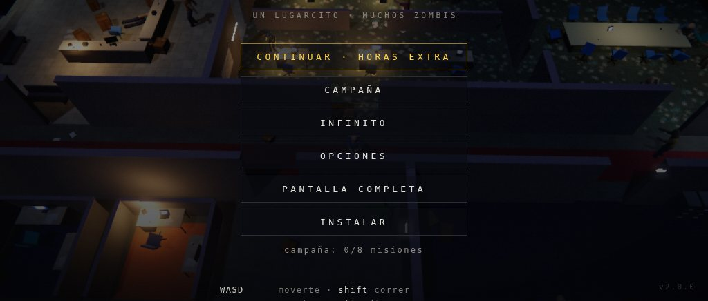
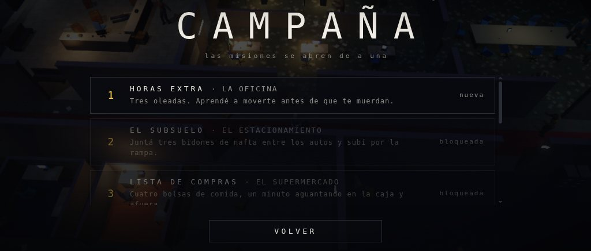
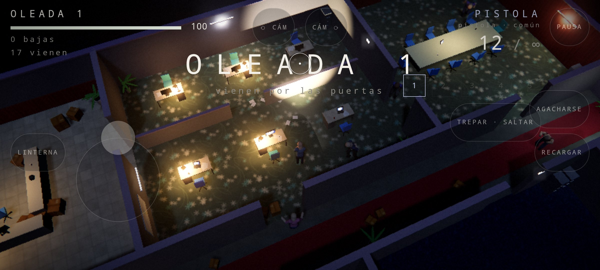

<p align="right"><sub><b>English</b> · <a href="README.md">Español</a></sub></p>

<div align="center">

# CARRONA

**Top-down zombies at night in five places. Every body is an active ragdoll, all the time.**

A physics engine of its own, muscles that are PD controllers, an inverse-kinematics gait and a
library of physical moves: twenty-five ways to get up, twenty-two to fall, six to
die, thirteen to jump, six to climb, twenty-one hit flinches, twenty attacks, eleven tics and
six hundred gait style combinations. One zombie in five hops around; two in
ten do parkour.
Five places (the office, the parking garage, the supermarket, the station, the hospital), an
eight-mission campaign with saved progress, endless mode, a full menu and options, in
Spanish and English. **One hundred and four weapons** with their own 3D models and textures, each with its own
shot: bullets, beams, rails, chain lightning, homing rockets, harpoons that stick,
grenades, flamethrowers, frost, acid, shockwaves and vortices; an armory where each one fires live and
a range to try them on. One `index.html`, ES modules, vendored Three.js. Zero dependencies
to install, zero texture or sound files: everything is procedural. For Windows there's an
installer and a portable zip with no dependencies; in the browser it installs as an app.




</div>

## What it is

A top-down shooter of waves and missions. The point isn't the weapons but the bodies:
there isn't a single animation clip in the project. Every zombie and the player are a skeleton
of particles moved by physics, and the only thing that changes between "walks", "runs", "slams
into the wall" and "dies" is how much force each muscle applies to reach its pose. A shot
in the arm switches that arm off. A shot to the chest staggers it two steps back, and there it
stays. A shot in the shoulder spins it around. A shotgun from the front sits it down backwards; from
behind, it sends it face-first. A runner that slams into a desk ends up hanging over it,
and then gets up: rolling and pushing with its arms, or springing up if it's in a hurry.

<div align="center">

|  |  |
|:--:|:--:|
| flashlight, blood and bodies that fall with their own inertia | a stampede of runners through a door |

</div>

## Playing

There are four ways; in the three Windows ones the game runs at `http://localhost:8765/` (ES
modules don't load from `file://`, which is why there's always a local server behind it; high scores and
settings live in that origin's `localStorage`).

**1. Installer (Windows 10/11, no Python or anything else).** Download `CARRONA-Setup-x.y.z.exe` from
[Releases](../../releases), run it and you're done: it installs per user (without asking for administrator rights) in
`%LOCALAPPDATA%\Programs\CARRONA` and leaves a **CARRONA** shortcut in the Start menu and, if
you want, on the desktop. The shortcut starts a local server and opens the game in a
window of its own (Edge or Chrome app mode). Windows will show the SmartScreen warning because
the installer isn't signed: *More info → Run anyway*.

**2. Portable zip.** Download `CARRONA-portable-x.y.z.zip`, extract it wherever you like and double-click
**`Jugar CARRONA.bat`**. It doesn't need anything installed either. If Windows marked the
extracted files as downloaded from the internet (Mark-of-the-Web), the `.bat` may show a
SmartScreen warning: *More info → Run anyway*; or, before extracting, right-click
the zip → *Properties* → *Unblock*.

**3. From the source.** With Python 3: `npm run serve` or `python serve.py` and open
`http://localhost:8765/` (`python serve.py 8766 --no-open --dir dist` for another port, without
opening the browser, or serving another folder). You can also use the Windows launcher from
the repo: `Jugar CARRONA.bat`.

**4. Android (APK).** Download the `.apk` from [Releases](../../releases) to the phone, open it and
install it (the first time, Android asks you to allow installs from that app). It's the same game
wrapped in a native app: fullscreen landscape, two floating sticks (the left finger
moves, the right one aims and fires when pushed) and buttons for everything else; the BACK button pauses.
The touch controls are covered in *Menu and options*; how the APK is built, in *Android*.

### Installing as an app (PWA)

When the browser offers to install the game, an **INSTALL** button shows up in the menu. The
browser only offers it if the game is served from the build (`dist/`, the installer or the zip): there
`index.html` carries a version mark and the *service worker* gets registered, which precaches all
the game files. Once installed, CARRONA sits in the Start menu like any other app, opens
in its own window and **runs without a server** until you clear the site data in the
browser. Each new build version replaces the whole cache and deletes the previous one.
From the repo (`serve.py`) the service worker is never registered, so development code
never ends up cached.

### How the launcher works

`launcher/carrona.ps1` is a PowerShell 5.1 script (the one that ships with Windows 10/11; it doesn't
need PowerShell 7) that:

1. Asks `http://localhost:8765/__carrona`: if a CARRONA is already serving (another double-click,
   or the development `serve.py`), it just opens the browser and exits.
2. Starts `System.Net.HttpListener` on `http://localhost:8765/` and serves the game folder
   with the right MIME types (`text/javascript` for the modules, `application/manifest+json`
   for the manifest), never stepping outside that folder. If the port is taken it tries
   8766 to 8775 (careful: on another port the saved high scores don't show up, they're per origin).
3. Looks up Edge or Chrome in the registry (*App Paths*) and opens it in app mode
   (`--app=`, no address bar) with a profile of its own in `%LOCALAPPDATA%\CARRONA\profile`.
   Without that profile the browser hands off to the instance that's already open and there's no way of knowing
   when the window was closed.
4. When the window closes, it shuts the server down and exits. If there's no Edge or Chrome, it opens the
   default browser in a tab and shuts the server down when the game reports that it was
   closed (`/__bye`) or after 90 s without requests.

`Jugar CARRONA.bat` and the installer's shortcuts invoke it with
`powershell.exe -NoProfile -ExecutionPolicy Bypass -WindowStyle Hidden -File`, so it doesn't depend
on the machine's execution policy. It logs what it does to
`%LOCALAPPDATA%\CARRONA\launcher.log`.

Known limitations:

- **Port taken**: if another program is using 8765, it falls back to 8766..8775 and the saved data
  ends up in another origin (it looks like the high scores were reset until the port is freed).
- **PowerShell group policy**: `-ExecutionPolicy Bypass` can't override a
  policy enforced by GPO (`MachinePolicy`/`UserPolicy`). In that case, option 3 still works
  (`serve.py`).
- **No Chromium browser**: Firefox or any other default browser opens the game in a regular
  tab, not in an app window.
- **SmartScreen**: neither the installer nor the `.bat` is signed; the first time, Windows asks
  for confirmation.
- On startup, the black console window flashes for an instant: it's `powershell.exe`
  starting up before it hides itself.

## The game

### The places

Five little places, each one a slab floating in the darkness with a chunk of building on top,
built with the same DSL (`src/game/level.js`) and registered in `src/game/maps.js` with their
seed, their navigation grid, their atmosphere (palette, moon, bloom, fog) and their texts.

| Place | What's there | Doors |
|---|---|---|
| **The office** | lobby, open-plan office, two meeting rooms, hallway, cubicles, kitchen | west, north, south, east |
| **The parking garage** | basement with columns, cars, toll booth, barrier arms, puddles, ramp, machine room; greenish tubes that flicker and fog | ramp, stairs, freight elevator, south |
| **The supermarket** | rows of aisles, lit fridges, cash registers, fruit and vegetables, storeroom with shelving, an OFERTA (sale) sign | entrance, storeroom, loading dock, east |
| **The station** | long platform with tracks and a stopped train car (the exit is its door), turnstiles, ticket office, tiled columns, benches, kiosks; sodium lights and fog | two tunnels, stairs, ticket office |
| **The hospital** | central hallway, rooms with beds and curtains, monitors, ER, gurneys, operating room, waiting room with a vending machine; cold lights that flicker and a red emergency one | ER, ambulances, elevator, ICU |

<div align="center">

|  |  |
|:--:|:--:|
| the parking garage: fuel cans among the cars | the supermarket: the shopping list |

</div>

Each map has named points (`L.point`): the exit and between four and six spots where
missions leave the things to collect. Switching maps tears the previous one down completely
(meshes, lights, statics, bodies, grid and horde) and builds the new one; the menu sits over the
last place played, with zombies wandering around.

### Campaign and endless mode

Five places and eight missions in order: each one unlocks when you complete the previous one, and the progress
(completed missions, attempts, best time, endless high scores) is saved in the browser.

| # | Mission | Place | What you have to do |
|---|---|---|---|
| 1 | Overtime | the office | survive 3 waves |
| 2 | The Basement | the parking garage | collect 3 fuel cans among the cars and go up the ramp |
| 3 | Shopping List | the supermarket | collect 4 bags of food, hold out for a minute and get out |
| 4 | Last Train | the station | 4 heavy waves (brutes from the second one on) and board the train car |
| 5 | Night Shift | the hospital | 60 kills, 3 boxes of meds and get out through the ER |
| 6 | Back to the Office | the office | 5 heavy waves with a shotgun and a rifle from the start |
| 7 | The Stampede | the parking garage | 3 minutes of stampedes through every door and the ramp |
| 8 | End of the Line | the station | 6 waves, 30 more kills and the last train car |

Objectives come in five types and go in order: survive N waves, kill N, hold out for T
seconds, collect N things scattered around the map (they show up with a column of light and a marker
on the HUD pointing to the nearest one) and reach a point (a beacon in the world and the marker
with the distance). Each map brings its own wave setup: the classic one, a light one for the
missions where what matters is moving, and a heavy one with brutes from the second wave on and
back-to-back stampedes. **Endless mode** is the never-ending waves of old, in any place
where you've already completed a mission (the office is open from the start); it saves the best
wave and the kills per map.

### The arsenal

<div align="center">

|  |  |
|:--:|:--:|
| the armory: every weapon fires live at a steel target | the range: homing micro-rockets |

</div>

One hundred and four weapons: the four classics (pistol, SMG, shotgun and rifle, with their
numbers untouched) and a hundred new ones named after mountains, winds, stars, critters or legends: HALCÓN,
JEJÉN, YAGUARETÉ, CERRO TORRE, PAMPERO, ZONDA, CRUZ DEL SUR, AURORA, CURUPÍ, LUZ MALA, POMBERO,
MANDINGA, HURACÁN. Fourteen families spread over five slots (sidearms, SMGs, shotguns,
rifles and heavy) and five rarities, each with its own color on the pickup sign, the HUD and the armory.

| Shot | What it does |
|---|---|
| **bullet** | hitscan against bones: pellets, penetration, ricochets off the walls, explosive rounds, suppressor, life steal |
| **beam** | continuous or pulsed laser, pierces, with a battery that recharges on its own (and overheats if you abuse it) |
| **rail** | charges up and goes through everything in its line, with a helix of light |
| **lightning** | finds the nearest zombie in a cone and jumps from one to the next, jolting them |
| **projectile** | with physics: rockets that accelerate, homing micro-rockets, grenades that bounce, cluster, sticky bombs, bolts and harpoons that stick, discs that bounce off the walls, flares, nails, plasma spheres, acid, vortices that suck everything in |
| **stream** | fire or frost in a cone; a wall cuts it off |
| **wave** | sonic: pushes and knocks down |

What's left behind after the shot: **fire** (damage per second, the body chars), **frost** (slows
it down; when full, it freezes it and the next shot shatters it for 50 % more), **shock** (it jerks and loses
control) and **acid** (damage per second and 25 % more from everything else). Fire puts out frost.
Projectiles know how to aim: grenades, acid, sticky bombs and vortices land in a
parabola where the mouse is; harpoons, bolts, flares and rockets fly straight at torso
height, with gravity compensated (a harpoon aimed at the first one in a row goes through two
and sticks in the third).

You start with all five slots full: your **loadout**, which you put together in the ARSENAL with EQUIP (one
per slot, out of the 104; also from the pause menu, and there it switches in your hands instantly). Between
waves the classics keep dropping if you aren't carrying them, plus one from the arsenal drawn by
rarity (rare ones weigh more as the waves go on); brutes drop weapons and, every
so often, so does a common zombie. Each weapon
goes to its slot: if the slot is free it's picked up on its own; if it's taken a sign shows up and **G**
swaps it (yours stays on the floor with the ammo it had). The collection is saved: the armory
shows how many you've found.

The **armory** (ARSENAL in the menu) holds all 104 as 3D thumbnails that render bit by bit, filters
by slot, stats and traits, and a live preview where the chosen weapon fires at
a steel target with the same ballistics as the game (drag to rotate, scroll the
wheel to zoom). **Try it on the range** takes it to the office with a light horde: practice doesn't
count toward any high score.

### Menu and options

<div align="center">

|  |  |
|:--:|:--:|
| the menu over the last place played | the campaign: missions unlock one at a time |

</div>

The menu is all buttons: CONTINUE (the next pending mission), CAMPAIGN, ENDLESS, ARSENAL,
OPTIONS, FULLSCREEN and, when the browser offers it, INSTALL. A click on a screen never
reaches the game: there's no way to start a match by accident. Esc closes whichever screen is
on top. When you die: retry or back to the menu; when you complete a mission: the next one, play again or the
menu. Pause freezes the simulation and the audio, and the game also pauses on its own if the tab goes to the background;
from the pause screen, ARMORY opens the arsenal to change the loadout without leaving the match.

The options are generated from a declarative registry (`src/game/options.js`): each option is
described once (key, group, type, range, default value, how it's applied) and from that come the
screen, the validation of what's saved and the persistence in `carrona.settings`.

| Group | Options |
|---|---|
| video | fullscreen, quality (minimum / mobile / low / medium / high), lower the quality automatically when it can't reach 45 fps (first the resolution, then the preset), shadows, bloom, show fps |
| audio | master volume, sound effects, ambience and music (three Web Audio buses) |
| game | camera shake, camera distance and pitch, look-ahead towards the mouse, language (Spanish / English) |
| controls | touch controls (auto / yes / no), touch fire (by pushing the stick / FIRE button), aim assist, controls size and opacity, left-handed, vibration; every action with configurable keys (click the key, press the new one; esc cancels), default keys |

The texts live in `src/core/i18n.js` in both languages; the language switches on the fly, without
reloading.

| Key (default) | Action |
|---|---|
| WASD / arrows | move (relative to the camera) |
| Shift | run (the weapon lowers, the body leans forward when it starts off) |
| C / Ctrl | crouch. C tapped while running: **dodge roll** |
| mouse | aim. Click fires (hold it down for automatics) |
| R | reload |
| 1 to 5 | draw whatever is in each slot (sidearms, SMGs, shotguns, rifles, heavy) |
| G | take the weapon on the floor when its slot is taken (yours stays on the floor) |
| Space | climb whatever is in front; running with nothing in front, **jump**; otherwise, shove. On the floor: get up right now |
| Q / E | rotate the camera 45° |
| wheel | zoom the camera in or out |
| F | flashlight |
| Esc | pause |
| F3 | performance panel |

With your fingers (phone, tablet or the Android app: they turn on by themselves when the primary pointer
is coarse; on a laptop with a touchscreen the mouse wins, unless they're forced on in the options):

| Gesture | Action |
|---|---|
| left finger, anywhere on the left half | **movement stick**: it appears where you touch down, moves relative to the camera and **follows the finger** (past the rim, the origin is dragged along behind it: changing direction is immediate). Speed is a single continuous curve from the dead zone to the rim: up to 70 % of the travel it grows up to walking (3.6 m/s), from there to the rim it blends smoothly into running (5.6 m/s); the running posture (weapon down, dodge, jump) kicks in at 85 % with hysteresis |
| right finger, right half | **aim stick**: it aims 6 m in that direction and **pushing it past halfway fires** (letting go stops firing; semi-automatics repeat on their own at their fire rate while it's pushed). Aim assist snaps to the nearest zombie within an 11° cone up to 14 m |
| FIRE | a separate fire button, if in the options you pick *touch fire: button* (the right stick only aims) |
| RELOAD · VAULT · CROUCH · LIGHT | the buttons on the sides. CROUCH is held down; tapped while running, roll |
| ⟲ ⟳ | rotate the camera 45° |
| TAKE | shows up with the name of the weapon on the floor when its slot is taken |
| HUD slots | tapping one draws that weapon |
| II | pause (in the app, also the system BACK button) |
| vibration | a short pulse per shot (with a frequency cap: an automatic doesn't saturate the motor), a longer one when you take a hit, one when you pick something up. It can be turned off in the options |
| left-handed | in the options: the right half moves, the left half aims, and the buttons are mirrored |

With the stick active, a faint thread links the player to the crosshair: on a small screen you can see
where you're aiming without hunting for the cross.

The sticks float on purpose: you never have to look where they are. Each finger is tracked by
its `pointerId`, so the two sticks and a button coexist without mixing; and if the app goes to the background
with a finger down, they're all released (nobody comes back to a match with the character walking on its own).
The math (dead zone, saturation, hysteresis, camera axes, aim assist) lives in
`src/core/sticks.js`, with no DOM, and `test/t_touch.mjs` tests it.

Weapons: **all 104 are available from the first mission**. You head out with all five slots
filled with your LOADOUT, which you put together in the ARSENAL with the EQUIP button (also from the pause menu,
and there the weapon switches in your hands instantly); by default, the pistol (infinite ammo), the
SMG, the shotgun, the rifle (goes through one body) and the common heavy weapon. Between waves weapons keep
dropping, drawn by rarity, so you can switch on the fly (see *The arsenal*). The head
takes ×4 damage. Limbs are severed by accumulated damage and without a leg
the zombie crawls. Between waves, ammo, medkits and weapons drop.

The player is **agile**: hitting a wall at full speed, they catch it with their hands and bounce off (without
crumpling), they shoulder-check a zombie out of the way without falling, and lying on the floor they don't wait:
pressing a direction they roll sideways or crawl that way and get up already running.

## Installer and distribution

### Build and release

```
node tools/icons.mjs        # regenerates icons/ (PNG 192/512/32, maskable and carrona.ico), deterministic
node tools/build.mjs        # builds dist/: game + launcher + icons + manifest, injects the version
                            # meta into index.html, generates sw.js with the precache, writes
                            # installer/version.iss and the zip CARRONA-portable-x.y.z.zip
node test/t_build.mjs       # tests the build (exact precache, zip, launcher, icons, serve.py)
```

The installer is compiled with [Inno Setup 6](https://jrsoftware.org/isinfo.php):
`ISCC.exe installer\carrona.iss` produces `dist\CARRONA-Setup-x.y.z.exe`. The version comes from
`package.json` (`src/core/version.js` has to match, `t_build` checks it).

To publish: bump the version in `package.json` and `src/core/version.js`, and push a
`vX.Y.Z` tag. The `.github/workflows/release.yml` workflow runs on `windows-latest`: it generates the
icons, runs the tests and the build, compiles the installer with the Inno Setup that comes with the
runner and creates the GitHub release with the `.exe`, the zip and the `.apk` attached. It can be launched
by hand (*workflow_dispatch*) to test without publishing: it leaves the files as artifacts.

### Android

<div align="center">



*the range on the phone: floating movement stick, buttons, the compact HUD*

</div>

`mobile/` is the native wrapper: [Capacitor 6](https://capacitorjs.com) with a single project
(`mobile/android`), no plugins. The game doesn't change: `tools/build.mjs --android` builds
`dist-android/www` (index.html, src, vendor, icons, manifest and LICENSE, with a
`carrona-platform` meta; no launcher, no `.bat` and no service worker, because the WebView serves the
files from the app and there's nothing to cache), `cap sync` copies it into the project and
Gradle builds the APK. `tools/apk.mjs` does all of that in one go:

```
npm ci --prefix mobile               # once: Capacitor and the icon generator (the game has no dependencies)
node tools/apk.mjs                   # web build → cap sync → assembleDebug → dist-android/CARRONA-x.y.z-debug.apk
node tools/apk.mjs --install --run   # also installs it and opens it on the connected phone or emulator (adb)
node tools/apk.mjs --release         # signed if mobile/android/keystore.properties exists; unsigned otherwise
```

You need JDK 17 or newer and the Android SDK (`ANDROID_HOME`, or Android Studio's in
`%LOCALAPPDATA%\Android\Sdk`; `apk.mjs` writes `local.properties` if it's missing). The app's version and
`versionCode` come from the root `package.json`: there aren't two places to update.

What the app does besides showing the game (`MainActivity.java`, sixty lines):

- **Immersive fullscreen** (the system bars hide; a swipe from the edge
  brings them back for a moment) and **landscape** (`sensorLandscape`: it rotates with the phone, never portrait).
- **The screen doesn't turn off** while the game is in the foreground (`FLAG_KEEP_SCREEN_ON`).
- **The BACK button goes to the game**: `carrona.backButton()` closes whatever is on top (pauses while
  playing, resumes from the pause screen, closes the options, comes back from the arsenal); on the main menu the app goes
  to the background (`moveTaskToBack`) instead of dying, so when you come back the match is right where it was.
- The origin is `https://localhost` (Capacitor's scheme): settings and progress live in
  that origin's `localStorage` and survive closing the app.
- `VIBRATE` permission: without it the WebView ignores `navigator.vibrate` and touch vibration doesn't work.
- `targetSdk 36` (what Google Play requires in order to publish): with 36, Android 16 turns on “predictive
  back” by default and stops calling `onBackPressed`, so BACK is handled with an
  `OnBackPressedCallback` from the AndroidX dispatcher (the same path on every version). And
  since Android 16 ignores the orientation lock on screens of 600 dp or more, the activity carries
  the `PROPERTY_COMPAT_ALLOW_RESTRICTED_RESIZABILITY` property to stay landscape on tablets.

The game knows it's running inside the app through `Capacitor.isNativePlatform()` (`src/core/pwa.js`): it hides
INSTALL and FULLSCREEN, turns on the touch controls and, the first time, starts at the
**mobile** quality (see *Render*). The app and the browser share exactly the same code: on a
phone, the game served from the web looks and plays the same, controls included.

In CI (`release.yml`) the APK is built on `ubuntu-latest` with JDK 17 and goes into the release along with
the installer and the zip. If the repo has the secrets `ANDROID_KEYSTORE_B64` (the `.jks` in
base64), `ANDROID_KEYSTORE_PASSWORD`, `ANDROID_KEY_ALIAS` and `ANDROID_KEY_PASSWORD`, it comes out signed
as `CARRONA-x.y.z.apk`; otherwise it comes out as `CARRONA-x.y.z-debug.apk` (debug signature: it installs
all the same, but a new version doesn't update one that was installed with another signature).

#### Google Play

Everything the store listing asks for is in `store/`: the texts in Spanish and English (`es-AR/`, `en-US/`,
within the 30 / 80 / 4000 character limits), the 512 icon, the 1024×500 feature
graphic, eight 1920×1080 phone screenshots (Play requires long side / short side ≤ 2), the
privacy policy (`PRIVACY.md`: the game collects nothing) and **`PUBLICAR.md`**, the complete
Play Console walkthrough with the answers to every form (content rating,
data safety, target audience, app signing). The art is regenerated with
`node tools/store_shots.mjs` (Chrome emulating a 1920×1080 phone, with the game served on
`localhost:8767`) and `python tools/store_art.py` (icon, feature graphic, 24-bit screenshots).
`node tools/apk.mjs --aab` builds the Android App Bundle signed with
`mobile/android/keystore.properties` and shows the certificate's SHA-256 fingerprint, and
`tools/play.mjs` uploads the listing and the images and publishes the AAB to a track through the official API
(`--listing --images`, `--upload <aab> --track internal|production`, `--dry-run`, `--selftest`)
with a service account from the console. `t_build` checks the art's dimensions, the text
limits and that no key is in git.

## The core

Twenty thousand lines of JavaScript without a framework. These are the pieces, and why they are the way they are.

### 1. XPBD physics engine (`src/phys/world.js`)

Extended Position Based Dynamics, written from scratch for this game.

- **Particles in flat arrays** (`px, py, pz, vx, vy, vz, invMass, flags`), no objects
  per particle. A single `Float32Array` per attribute, so the hot loop doesn't chase pointers.
- **Substepping**: 7 substeps per frame at 60 Hz, that is, 420 Hz of physics. Constraints are
  solved once per substep instead of iterating many times per frame; it's the variant that
  best preserves stiffness without the energy blowing up.
- **Distance constraints with compliance** (the "X" in XPBD): near-rigid bones, minimum and maximum
  range limits for elbows and knees, and soft constraints for the torso.
- **Collision**: particles against the floor, oriented boxes and cylinders, with a spatial hash of
  0.55 m cells for particles against each other. On top of that, **bones collide as capsules**, not just their
  endpoints: against the world (a body can end up hanging from the edge of a desk) and against
  other bodies' particles (a leg kicks a box, an arm rests on another torso).
- **Per-owner gain**: each particle knows which body it belongs to. A body without muscle can't
  push one with muscle more than 10 % per substep, and there's a 9 m/s cap for bodies
  without control. Without that, a stampede worked like a bulldozer and sent bodies flying 60 meters.
- **Capped expulsion**: the penetration correction is capped to the substep's actual movement,
  so a large overlap is resolved over several steps and not like a gunshot.
- **Raycasts against statics** for aiming and for the bodies' root, and `compact()`
  to recycle particles from bodies that no longer exist.

Cost, measured with the CPU otherwise idle: 40 ragdolls plus 40 boxes and 12 cylinders in 9 ms per frame;
916 particles with 3250 constraints in 11 ms.

### 2. Active ragdoll (`src/phys/ragdoll.js`)

A humanoid of **16 particles and 15 bones** (head, neck, chest, shoulders, elbows, hands,
hips, knees, feet) with a reference pose in meters (`skeleton.js`). On top of that base:

**Muscles as a PD controller, not as a spring.** Each particle has a target (its place in
the pose, already rotated and offset with the root). On every substep the muscle pulls the position
toward the target (proportional term) and then blends the particle's velocity with the
body's velocity (derivative term), with **critical damping**:

```
a = (1 - phys) · min(1, max(0, (m - 0.02) · 14)) · min(1, 1.45 · sqrt(kSub · m))
```

`m` is the strength of that particle's muscle, `kSub` the substep's position gain. With
infinite damping the body reached its pose exactly and looked like a mannequin; with less than
critical it oscillated at 18 rad/s around the pose even at 1 % strength and every shove bounced.
With this the torso stays firm and the head and arms arrive with a lag and a small
overshoot, which is what reads as secondary motion. Falling or dying, the
damping switches off entirely: inertia takes over.

**Virtual root on a leash.** The body doesn't move by pushing particles: what moves is an
invisible point (the root) that the pose is anchored to, and the muscles follow it. The root advances per
substep (not per frame, so there's no sawtooth), never crosses a wall (a raycast
before every step), doesn't walk into another standing body (it slides tangentially around it and
the two bump into each other) and has a leash: if the body falls behind by more than a certain length,
the root waits. Falling, the pose is anchored to the real body's **center of mass**: the muscle shapes
the limbs without pushing the whole, and the momentum it carried is conserved.

**Velocity with inertia.** The velocity requested by the AI or the player ramps at 9 m/s² when
accelerating and 14 when braking. Starting and stopping take time and the body **leans into the effort**:
the difference between the velocity it wants and the one it has turns into a lean of the
torso, forward when starting off, backward when braking. In **turns it leans inward** (more
the faster it goes), the head **anticipates the turn** by looking where it wants to go before the
body gets there, and when **pivoting in place** the feet take little sidesteps instead of sliding.

**Inverse kinematics gait.** There's no recorded walk cycle. Each foot follows a
trajectory: a linear stance at the body's speed and an arced swing, with a stride proportional to
the speed and in the direction of movement (the player sidesteps while aiming
elsewhere; a shot makes the body step backward). The knee is solved with two-bone IK
using the real length of the thigh and the shin, always bending forward. Walking, jogging and
running are the same gait blended by speed: a minimum knee angle of 125°, 103° and 89°, a foot that
lifts 16, 26 and 34 cm. The elbows also come out of IK, and the walking and running arm
styles **blend continuously** (a hard switch threw the hands almost a meter in a single frame).

**Planted feet, with weight.** The gait phase advances with how far the root advances (not with
time, nor with a cadence floor), the stride of the pose and that of the cadence are the same
(style included) and the limping leg takes a shorter step by shortening its stance, not by going
slower: by construction, the planted foot moves backward at exactly the speed of the
ground. On top of that, while a foot is in stance its target is **frozen in the world** where it touched the
ground (the root advances per substep and the local target is computed per frame: without this the foot
drifted 6 cm forward and snapped back), the knee is solved for the planted foot and
not for the one on the trajectory, and it's released only when the nearly straight leg can no longer reach (just
once per stride, blending the target over a tenth of a second). The foot's swing is a
Hermite curve that **lands already moving backward** (the foot "paws" the ground on landing, like a
runner's) instead of arriving at rest relative to the body. When running, the **flight phase** shows up
(a stance of 64 % of the cycle) and the **pelvis drops** as far as the stance leg can reach: the knees
always stay somewhat bent, the hips rise and fall with the stride and the foot touches the ground on
every step (before, it floated a centimeter above it, hanging from the muscles). Planted-foot sliding, measured:
0.2 m/s walking and 0.3 running (it used to be 0.6 and 0.8).

**Real joint limits.** Particles have no angles, but the direction of each
segment relative to the torso frame does get constrained, per substep and gradually (2 cm, half of
the correction, so it converges without fighting). Knees and elbows are **hinges with a cone**: the
joint can only leave the hip–foot line toward a 65° cone (80° for the elbow)
around the nominal flexion, so the knee doesn't bend backwards or end up 30 cm off to the side like
a broken stick; without muscle the cone opens almost all the way (a corpse's knees fall
sideways) and the hips relax outward (the "tented" legs of a body lying face up
fall on their own, little by little). **Hip, shoulder and neck cones**: the thigh up to 45° backward, 50°
outward, 20° crossed, and the knee doesn't rise more than 30° above the hips; the arm up to 48° behind
the plane of the chest and 27° crossed; the head 50° and the neck 35° relative to the trunk, with a
minimum head–chest stop so the neck bends up to 64° and doesn't fold into the ribcage.
**Minimal self-collision**: hands and elbows are spheres against the chest–hip capsule and against the
head (in a face-first fall the hands used to go right through the chest). And **the bones have the
last word**: at the end of each substep, after contacts and limits, a rigid pass over
the fifteen bones and the torso braces (two sweeps at the end of the frame) leaves the skeleton
at its exact length; the target pose is also relaxed to the real lengths before being used, so the
muscle never asks for a stretched bone. Maximum stretch, measured: 2 % standing, 8 % in a pistol
flinch (it was 37 %), 26 % in a crowd of twelve getting crushed (it was 116 %).

**Capture-point balance** (what Euphoria does). Every frame computes where the body is going to
be a quarter of a second from now relative to where it should be (the root): the position
that went past the leash plus `τ · (center-of-mass velocity − center-of-mass velocity
of the target pose)`, because leaning when starting off or the stride move the center of
mass on purpose, and that isn't losing balance. Braking against something is discounted (crashing
takes care of that), changing your mind gets a third of a second of grace (the player cutting at
90° doesn't fall for cutting) and the deciding error is filtered over 50 ms: a real shove changes
the body's velocity and stays, a one-frame jump goes by without a trace. With a
small error the **arms come out to balance** in proportion (windmilling back and up if it's tipping
backward, out and down to brace if it's tipping forward) and the trunk leans against it; past a
threshold it takes **recovery steps** that way; past another, it falls with a fall chosen by the
direction. Measured: twenty walking styles, thirty running ones, starting and stopping, running in
a circle, the player zigzagging and backing up, without a single false stumble; a sustained
60 cm shove produces one recovery step and it stays on its feet.

**Fall reflexes** (Euphoria again). When falling without control, three reflexes that last half a second are layered
on top of the fall choreography: the hands go to the **predicted impact point**
(where the chest is headed with its current velocity, in the time it takes to reach the floor), not where
it's looking; falling backward, the **chin tucks into the chest** so the back of the head isn't the first thing
to hit; and if the head is going to hit (it's dropping fast and already close) the hand on that side slips
**between the head and the floor**. The reflexes are pose targets with the arms and the neck
stiffened two and a half times (a limp arm stops nothing): that way the arm really absorbs the blow.
Measured: pushed from the front, the hands touch the floor at 0.52 s instead of 0.68 and the head arrives
at 0.8 m/s instead of 1.1. And after a shot or a shove, for one second the head **looks toward
where it came from**, over the shoulder if needed (the threat overrides the AI's gaze).

**Weight in the gait.** The pelvis rotates with the stride (the hip of the leading leg
moves forward, up to 8°), the shoulders rotate the opposite way (counter-rotation, 6°) and the head bobs and
sways half as much as the chest, like a real one: without this the trunk rode on
the legs like a block.

**Knees never backwards.** A large violation of a hinge or of a hip cone (the
knee 20 cm backwards, crushed by the crowd, the leg splayed at 90° by the drag of a
sliding body) is corrected hard and all at once, but **without velocity** (the
previous position moves too): as a constraint, 7 cm in one substep put 30 m/s into the knee and the body
blew up. Only knees and hips, and only with muscle (or while a corpse slides): on elbows
and shoulders it fought the arm reflexes, which do carry velocity, and on a still corpse
it turned a backward knee into a sideways knee. Measured: a shotgun from the side at a
runner, the backward knee goes from 37 % of the frames to under 10 %; in jumps, from
24 % to 2 %.

**Sliding with momentum.** The floor has **static** friction (0.92: a planted foot grips, a
body that collapses in place doesn't sprawl) and **dynamic** friction (0.30) for a body that's already
sliding as a whole, fast: a dead runner at 3.8 m/s covers 2.5 m in total and slides almost a
meter along the floor before stopping, instead of sticking where it landed; while it slides and for half a second
after, the hips close with a living body's strength so the drag doesn't spread its legs apart.

**Corpses that settle.** A body without muscle (dead, lying down) carries a **viscosity
toward its own rigid field**: the rigid-body motion that best describes
all the particles is computed (center of mass, angular momentum, inertia tensor) and each velocity is
blended a little toward that field, so linear and angular momentum are conserved (the fall keeps
flying with the impulse it had) but the internal jitter dies out. Freshly dead, there's half a
second of **residual tone** (it falls like dead weight, not like a sack) and a severed piece (the
flying head) has its own group: the body doesn't hold it back. Measured: a corpse is still
(< 1 cm/s) two and a half seconds after dying and doesn't move again for ten.

**Gait styles** (`moves.js`): each body draws a walking style and a running style when it spawns,
and blends them according to the gait. **Thirty running styles**: sprint, charging with the arms
back, flailing arms, long strides, like a bull with its head down, windmill, limping,
crouched, stomping, bounding, claws forward, the classic with stiff arms,
**muscleless arms that hang and flop** (pure physics), one arm raised, hugging itself,
hands on the head, gorilla with its knuckles grazing the floor, screaming with the head thrown back,
arms swept back like wings, hands up high to grab you, athlete, arms crossed, half
sideways, gallop (the legs out of antiphase), bouncing, on tiptoe, shuffling
feet, drunk zigzag, leaning back, stiff legs. **Twenty walking styles**: shuffling
feet, dragging a leg, stiff, hunched, arms outstretched, twitchy, swaying,
lopsided, staggering, limping, almost crawling, migraine, hugging itself, claws, proud, crab,
dainty, springy, dragging itself, howling. Six hundred combinations: a horde doesn't look cloned.

**State machine and move library** (`moves.js`). A move is a
sequence of target poses generated by functions, with a per-limb muscle profile,
root motion, frame turns and one-off impulses. The muscles pull toward those poses and
physics does the rest: that's why a get-up bumps into the desk next to it.

| State | What runs |
|---|---|
| standing | the gait with its style, plus **overlays** that stack without interrupting it: **twenty-one flinches** per shot (the head snaps away, whiplash, the chest folds, the back arches, it doubles over at the stomach, the shoulder spins it, the arm flies, the hips shift or twist, it tilts, the leg hops, the knees give, it clutches its arm, face or belly, convulsion, a shrug, arms reaching for balance, it nearly collapses), **five sustained wounds** (a hand pressing the head, the belly, the shoulder or the thigh while it keeps going), **twenty attacks** and eleven idle tics |
| staggering | real steps in the direction of the hit with a whiplash of the torso; the root goes along and the body **stays displaced**, it doesn't snap back like rubber |
| jumping | a crouch beforehand without breaking the gait, a real kick to every particle and the pose **anchored to the ballistic arc** (the PD controller chases the arc's vertical velocity, so the body really flies and lands with impact). **Thirteen figures**: hop, leap, stride, cannonball, dive, flying kick, flying knee, star jump, clawing the air, letting itself drop, hurdle, wall bounce, excited hop. On landing it flexes according to the height; the agile one rolls; the clumsy one collapses |
| climbing / climbing down | the anchor rises from the floor to the top (or comes down) with the style's curve. **Six climbs**: classic (hands, knee, up), a quick pass with one hand and the legs swinging over sideways, kong (two hands, hips up, legs between the arms), dash (legs first, hands behind), belly over the top, frantic on all fours. A low hurdle at a run is cleared without hands; the parkour one dives headfirst over it and rolls. Sometimes it goes wrong: it catches the edge and tumbles over it. **Climbing down**: it sees the edge half a meter ahead and chooses: step by step, sit down and drop, hop, jump, jump and roll, or trip |
| move | short sequences that hand back standing control: forward roll, shoulder roll (parkour), backward roll, sideways roll along the floor, a quick crawl that turns into a run, baseball slide, shoulder charge, a sudden crouch, staggering steps |
| falling | one of **twenty-two falls** chosen by cause and angle: sitting down backwards, stiff as a board, face-first, to the knees and then face-first, sideways, spinning, collapsing, flying, somersault (the runner), bouncing off the wall, face into the wall, spinning and sliding down the wall, collapsing against the wall, tumbling over an edge, face-first without hands, sideways roll, helicopter, slip, three steps and down, sliding on the knees, failed dive, tackle |
| lying down | pure physics, stunned for a time that depends on the type (the runner 0.35 s, the brute 1.3 s, the player 0.28 s) |
| getting up | one of **twenty-five get-ups** chosen by how it ended up. Face up: sit-up, roll and push, spring up, heavy, roll and crawl, backward somersault, dizzy and lopsided, the roaring brute. Face down: push-up, knee first, roll and sit, crawl, quick, explosive from a sprinter's start, crawl and break into a run, the one that fails halfway and tries again. On its side: to face down, to face up, onto the elbow, sweeping the legs. From kneeling: normal, spring up, launching into a run. From sitting: normal, pivoting on one knee. The weight of each one depends on the body type and on the parkour trait |
| resting | asleep on the floor or sitting against the wall until something wakes it; then it gets up accordingly |
| dying | one of **six deaths**: it collapses, walks wounded and falls, drops to its knees and onto its face, arches backward, spins and falls, doubles over and goes down sideways. A headshot is instant |

**Hit reaction**, the "physical animation" pattern:

1. A local impulse at the point of the bone that was hit: the limb flies off and the torso turns if the
   shot was off-center.
2. A flinch chosen by zone and angle (the table above), on top of whatever it was doing.
3. A stagger with real steps in the direction of the shot; the balance target moves.
4. A shot in the shoulder spins the body. A shot in the leg while running trips it (the
   runner does the somersault and keeps going); standing, the knee buckles, or it collapses if the shot was strong.
5. A lot of momentum in a short time (shotgun, burst) knocks it down, with a fall chosen by the angle.

**Collisions at a run.** Against a wall head-on, it depends on who: the agile ones (the player, the
parkour one) **catch it with their hands**, bounce off and stagger back without falling; a fast
parkour one plants a foot and **pushes off backward and up**, spinning in the air; the rest bounce and
fall, smash face-first, spin and slide down the wall until they're sitting, or their
legs buckle against it. Against the edge of a desk it didn't manage to climb: it tumbles over it. A glancing
blow: it scrapes its shoulder, spins and keeps staggering along the wall. Against another body:
from behind, the one in front falls on its face and the one behind trips over it; head-on, at higher
speed both go down; from the side, a shoulder bump that spins the other one around; the agile one
barrels through with its shoulder and keeps going. Feet that catch on a corpse or a box trip.

### 3. Navigation (`src/game/nav.js`)

The level is rasterized into a 0.4 m grid with a 0.30 m margin and a **flow
field** is computed with Dijkstra from the player. Each zombie reads the direction of its cell: a hundred bodies
cost the same as one. Furniture with a top below 1.05 m doesn't block the way, so
the flow goes over desks and tables and the zombies climb them instead of going around.

### 4. The horde (`src/game/zombie.js`, `src/game/game.js`)

Left 4 Dead style: **they all run** when they're chasing you, each in its own way.

| Type | Wandering | Chasing | Trait |
|---|---|---|---|
| walker | 0.35 to 0.7 m/s | 2.6 to 3.3 m/s | shuffles its feet until it sees you |
| jogger | 0.45 to 0.85 m/s | 3.0 to 3.7 m/s | most of the horde from wave 2 on |
| runner | 0.55 to 1.0 m/s | 3.7 to 4.6 m/s | light, crashes into everything, tackles |
| brute | 0.35 to 0.55 m/s | 1.7 to 2.2 m/s | 1.8 mass, takes 2.6 times more, a hammer blow that floors you |

States: asleep (wandering, or resting sitting, kneeling or lying on the floor), alert (it
saw you, heard you or you hit it: it turns around, half a second of reaction, and charges), chase
(flow field from afar, straight at you up close, separation between bodies and flanking to surround you), attack.

**Traits.** One in five **hops around**: it bounces while running with a figure of its own
(leap, stride, kick, clawing the air), jumps with excitement two or three times when it sees you and
rocks on its knees when it's standing still. Two in ten do **parkour**: they cross
desks with a kong or a dash, or dive headfirst over them and roll; they jump down and roll
on landing; they bounce off walls with a foot; they launch a dive from three meters away; they get up
with a somersault or spring up; and their agility shows in everything else too.

Flights are an **event, not the rule**: one at a time and with a cooldown of several seconds.
Most of them reach you running, and the runner doesn't brake near you: if you step aside, it goes right past you
flailing and crashes into whatever is behind. A dive that **catches you** lands on top of you and knocks you
down; when it misses, the runner lands on its feet, staggers and keeps running (the parkour one
rolls, the walker lands on its belly).

| Attack | Who | What it does |
|---|---|---|
| right or left swipe, backhand, claw, double claw | everyone | shove |
| double swipe | everyone | strong shove |
| grab, lunging grab, grab and shake, neck bite | walker, jogger | holds you back for an instant |
| bite | everyone | the head goes for the neck |
| headbutt, knee strike | everyone | big stagger |
| kick | jogger, runner | a shove with the leg |
| uppercut | jogger, runner | lifts you up |
| windmill | everyone, rarely | a full swing of the arm: floors you |
| flurry | runner | three swipes in a row |
| stomp | everyone | only if you're on the floor |
| hammer blow, fists to the floor, brute windmill | brute | floors you |
| charge | brute, runner | lowers its shoulder from three meters away: floors you |
| tackle | runner | dives headfirst: both of you go down |
| **dive** | runner, parkour | launches through the air from three meters away and lands on top of you: both of you go down |
| flying knee | parkour | jumps knee-first: floors you |
| dropping on you | anyone on top of furniture | throws itself from the desk onto you |

Bodies far from the player skip the bone collision passes (`lod`). From the
first wave on there are **stampedes**: a group of runners comes in together through a door every 14 to
34 s. Each wave also leaves a few sleepers in the corners.

### 5. Props and corpses (`src/game/props.js`)

Boxes, chairs and plant pots are rigid clusters of particles. When they stay still they **fall asleep
and become static colliders** of the world: they stack, hold bodies up and cost nothing.
They wake up when someone gets close or they get shot. A dead body that stopped moving
freezes the same way: its bones go into a corpse buffer and it stays there as a low obstacle that the
living have to get around or step on.

### 6. Weapons (`src/game/catalog.js`, `weapons.js`, `ballistics.js`, `status.js`)

Hitscan against bones (capsules) and statics, with pellets, spread, recoil, damage
falloff on the shotgun and penetration on the rifle (it goes through one body with 60 % of the damage). Each
bone has hit points of its own; only the shotgun and the rifle can sever a limb.

- **The catalog** is data: each weapon is a short entry (family, rarity, numbers, model
  parameters, finish palette, shot) that gets merged with its family's values, validated
  ONCE at load time (a broken field throws with the name of the weapon and of the field) and frozen.
  Precomputed indices by slot and by rarity; the reward draw is an O(n) roulette wheel with
  weights that grow with the wave.
- **The arsenal** is a state machine per slot: bursts, minigun spin-up, rail
  charge, a battery that regenerates and overheats, reloading, and the leftover of the fire rate carries over
  to the next shot (a minigun at 26 shots per second fires 26, not 20 because of rounding to the frame).
- **Ballistics** knows nothing about the game: the world gives it the geometry (raycasts against bones and
  statics, line of sight) and a sink takes the consequences (damage, blood, status effects, sound). The
  armory uses the same class with a fake world: the menu's shot is THE shot. Projectiles
  sweep each step against bones and statics (the nearest one wins), ignoring the ones they already
  went through; the launch angle comes from the rationalized ballistic formula, with no cancellation
  when gravity is small. Explosions have quadratic falloff, walls block them (line
  of sight to the chest), they sever limbs near the center and push everything that has particles.
- **Status effects** (fire, frost, shock, acid) live in the zombie and in a set of affected ones:
  the step costs O(affected), not O(horde), and a kill from damage over time belongs to the weapon that started it.
- **The hit reaction is physical, part by part.** The muscle is a PD controller with
  critical damping at 420 Hz: firm, it erased a bullet's impulse in three substeps and a pistol
  shot moved the shoulder 8 mm (what you saw was the flinch pose). Now the impact
  **loosens the muscle around the bone that was hit**, more at the end where it hit, half one
  bone away, a quarter two bones away, capped at the trunk and at the feet (they hold the body up), and
  the muscle comes back on its own, more slowly the more momentum the shot carried. So the shoulder goes 15 cm
  back, the head 10, the hand 15, and the joint stops brake them. The loosened particles
  have a PD of their own (critical even if the body is stunned) and go back to the pose at the pace of a
  muscle, not a spring: no whiplash (the head used to bounce 23 cm forward at 6.5 m/s). A limb
  without muscle is meat, not rope: it doesn't go past 4 m/s relative to the body. The bullet spreads its momentum across
  the tissue: no particle gets more than 3.5 m/s from a single one. An off-center shot to the trunk turns the
  body by its real lever arm. The joint stops (minimum and maximum) are inelastic: the
  previous position moves with the correction, so the stop holds without kicking (a leg that
  straightened all of a sudden used to catapult the body 3 m). A leg that gives way to a shot collapses, it never
  “goes flying”, and a sniper shot to the leg brings the body down instantly.

| Weapon | Damage | Fire rate | Magazine | Impulse |
|---|---|---|---|---|
| pistol | 30 | 6.5/s | 12, infinite reserve | 7 |
| SMG | 17 | 13/s | 32 | 4.5 |
| shotgun | 14 × 9 pellets | 1.3/s | 6 | 9 |
| rifle | 44 | 8.5/s | 30 | 13, goes through |

### 7. Player (`src/game/player.js`)

It's one more ragdoll, with its yaw locked to the mouse and its arms in "aim" mode. It walks at 3.6
m/s, runs at 5.6, and crouched at half that. Running without firing, the weapon lowers and the arms pump;
at the first shot it comes back up front. Recoil and reloading move the hands through physics, not through a clip.
A swipe makes it stagger with its torso folded; a hammer blow or a tackle knocks it down and it has to
get up. A shove to get zombies off, health that regenerates if it's left alone, and it
dies like everyone else: the muscles switch off.

### 8. Render (`src/render/`)

- Vendored Three.js r160 (no CDN), ACES pipeline, MSAA, soft PCF shadows, bloom.
- **Instanced mannequins**: each bone is a low poly capsule positioned from the
  particles; a single draw call for the whole horde. Frozen corpses live in
  a separate buffer that is never touched again.
- **Procedural materials**: beige floor tiles, floral, gray and blue carpets, aqua green wall tiles,
  wooden planks and the hallway's red carpet are painted on a canvas at startup.
- Flat-colored low poly models: desks, chairs, monitors, plants, boxes, doors,
  tube lights. A minimalist style with real lighting: moon, fluorescent tubes, a flashlight
  with shadows.
- FX: blood as decals and particles, muzzle flash, tracers, shell casings.
- **Adaptive quality**: five presets. On desktop, `bajo` (low, dpr 0.70), `medio` (medium, dpr 0.90 with
  MSAA 2) and `alto` (high, dpr 1.25 with MSAA 4). For phones, `movil` (mobile) isn't defined by dpr but by
  **render width** (1100 device px on any screen, with shadows and bloom) and
  `minimo` (minimum) is the floor (900 px, no bloom, small shadow maps: a Mali-G57 drew `movil`
  at 35 fps). If it can't sustain 45 fps it drops one step on its own, and the steps are fine-grained:
  first the **dynamic resolution** (100 → 85 → 70 % of the preset, without a notice) and only then the
  preset (with a notice). It never goes back up on its own; the preset is saved and the dynamic resolution is
  readjusted every session (on a Redmi Note 14 Pro, `movil` at 70 % gives 56 fps). `minimo`
  keeps the shadows on purpose: turning them off
  changes the programs and recompiles every material (seconds frozen on a phone), and
  that hitch would happen in the middle of a match; shadows on or off stays the user's call.
- **The simulation runs in real time even when drawing can't keep up**: the loop splits each frame into
  steps of at most 1/30 s (`splitStep`, up to three per frame) and the physics, the horde and the
  projectiles advance through all those steps; drawing happens once. Before, `dt` was capped at 1/30 and a
  phone at 25 fps ran at 80 % speed, and at 100 % when it picked back up: “it moves slow and then
  fast”. Below 10 fps it resigns itself to running slower rather than going into a spiral.
- **The gunsmith** (`gunsmith.js`): sixteen parametric builders (pistol, revolver,
  SMG, shotguns, rifles, sniper rifle, machine gun, minigun, launcher, energy,
  exotics) assemble each model out of beveled low poly parts and profile extrusions, grouped
  by material and by animated part (slide, cylinder, bolt, pump, spinning barrels). About
  1500 triangles and 10 draw calls per weapon; the cap is 6000 and 16.
- **The finishes** (`finish_recipes.js`, `finishes.js`): twenty-seven texture recipes in pure
  JS (polymer, cerakote, stippling, brushed, parkerized, blued, chrome, gold, wood,
  carbon fiber, woodland, digital, tiger and jaguar camos, damascus, hexagons, panels, hazard
  stripes, rust, tape, rubber, enamel, circuit board, knurling, ivory, bronze, frost) with color,
  normals, roughness and emission. The noise lives on periodic lattices: it tiles seamlessly by
  construction. Single-color recipes are computed once in gray and the color goes into the
  material: the 104 weapons use 46 textures. They're baked in Workers while you're looking at the menu (the
  same code, the same bytes) and uploaded to the GPU one per frame.
- **The shots** (`shotfx.js`): muzzle flashes, tracers that travel, trails, beams, rail
  helices, lightning, sparks, fireballs, shockwaves on the floor and smoke in one instanced
  sprite batch (a single draw call) with a shape atlas computed in JS; shell casings by
  caliber and scorch marks on the floor.
- **No shader compiles during play** (`warmup.js`). Three compiles a material's program
  the first time it draws it, and on an Iris Xe a program with twenty lights takes 1.5 s: the
  first shot froze the screen for several seconds. Now the light topology is fixed (every
  map with twenty point lights, the missing ones kept as spares and switched off; the muzzle flash is never
  switched off with `visible`, only its intensity changes; fog always on), the 104 weapons
  share a single program (the four texture maps always present, 1×1 neutral ones where the recipe
  has none), and while you're looking at the menu everything is precompiled on other threads
  (`KHR_parallel_shader_compile`), with the same render target as the real pass, samples of what
  doesn't exist yet and a rehearsal frame that shows even the empty pools (`compile()` doesn't see
  the shadow programs). The menu appears right away and the scene fades in
  once everything is ready; a match doesn't start until it has its shaders. In the tests:
  twelve weapons firing, zero new programs.

### 9. Audio (`src/audio/audio.js`)

Everything synthesized with Web Audio in real time: shots, reloads, growls, impacts, ambience.
There isn't a single sound file. Each weapon has its own firing profile built from layers of filtered
noise, tones, FM and crackle (thirty-nine profiles; the classics' ones didn't change),
and the ones that need it, a continuous hum: the minigun's spin, the rail's charge, the stream.

## Structure

```
index.html                 HUD, screens (menu, campaign, endless, options, pause, death, victory), importmap
src/main.js                startup, the UI (screens, generated options, scoreboard) and the loop
src/core/                  util (rng, clamp, angles), input with configurable actions and the virtual layer
                           the sticks write to, sticks (the math of the touch controls, no
                           DOM), touch (the floating sticks and the buttons), i18n (es/en), version,
                           pwa (installing as an app, service worker, detecting the native app)
src/phys/world.js          XPBD engine
src/phys/skeleton.js       particle indices and reference pose
src/phys/ragdoll.js        active ragdoll: PD muscles, virtual root, IK gait, states, reactions
src/phys/moves.js          poses, falls, get-ups, deaths, flinches, attacks, tics, styles
src/game/level.js          the places DSL (walls, floors, furniture, lights, named points) and the
                           five places: office, parking garage, supermarket, station, hospital
src/game/maps.js           map registry: builder, seed, grid, atmosphere, texts
src/game/mission.js        the campaign (eight missions), the wave setups and the objective manager
src/game/progress.js       saved progress: completed missions, times, attempts, endless high scores
src/game/options.js        declarative registry of options and keys; validation and persistence
src/game/nav.js            flow field
src/game/zombie.js         horde AI
src/game/props.js          rigid props that fall asleep
src/game/catalog.js        the catalog: 104 weapons in 14 families, rarities, slots, validation, draw
src/game/weapons.js        slot-based arsenal (burst, spin-up, charge, battery) and hitscan
src/game/ballistics.js     what a shot does: rails, lightning, projectiles, explosions, streams, waves
src/game/status.js         fire, frost, shock and acid
src/game/player.js         player
src/game/game.js           states, maps, matches, parameterized waves, stampedes, sleepers,
                           pickups and objectives, shooting, corpses, HUD, pause, settings
src/render/                renderer, materials, instanced bodies, props, FX, models, shaders
src/render/gunsmith.js     the gunsmith: parametric models of the 104 weapons
src/render/finish_recipes.js  the 27 texture recipes (pure JS: they run in Workers and in Node)
src/render/finishes.js     weapon textures and materials, the Worker oven, the studio reflection
src/render/finish_worker.js   the oven's Worker
src/render/shotfx.js       the shot effects (instanced sprites, projectiles)
src/render/armory.js       the 3D armory: thumbnails and a preview that fires
src/render/warmup.js       shader precompilation
src/audio/audio.js         synthesis
vendor/three/              Three.js r160 and the postprocessing addons in use
launcher/carrona.ps1       Windows launcher: HttpListener on localhost:8765 + browser in app mode
Jugar CARRONA.bat          double-click → launcher\carrona.ps1 (PowerShell 5.1, no Python)
manifest.webmanifest       name, icons, fullscreen, landscape orientation
sw.js                      service worker: versioned precache (the build fills in the placeholders)
icons/                     icons generated by tools/icons.mjs (PNG and carrona.ico)
tools/                     icons.mjs (icons), build.mjs (dist + zip + version.iss; --android builds
                           dist-android/www), apk.mjs (web build → cap sync → Gradle → APK), zip.mjs
installer/carrona.iss      Inno Setup 6 installer (version.iss is generated by the build)
mobile/                    the Android app: Capacitor 6 (capacitor.config.json), the native project
                           (mobile/android: immersive landscape MainActivity, BACK button to the game,
                           signing from keystore.properties) and the icon sources (mobile/assets)
.github/workflows/         release.yml: build + installer + release when a vX.Y.Z tag is pushed
serve.py                   development server (localhost:8765, --dir, --no-open)
test/                      Node suites and browser harnesses
docs/                      screenshots
```

## Tests

The suites run in Node without a browser and measure real physical behavior: distances, angles,
times, velocities.

```
npm test                       # all nineteen suites
node test/t_world.mjs          # engine: stability, collisions, soft expulsion, performance
node test/t_ragdoll.mjs        # ragdoll: standing, gait at 1.4 m/s, death, dismemberment, 40 bodies
node test/t_nav.mjs            # flow field, climbable furniture
node test/t_props.mjs          # sleeping, waking up, stacking
node test/t_realism.mjs        # hanging from a desk, crashing into a wall, getting up, limits
node test/t_horde.mjs          # horde + weapons + player, deterministic penetration
node test/t_stampede.mjs       # collisions at a run, trips, gaits, sidesteps
node test/t_hits.mjs           # hit reaction by direction, zone and momentum, and the local physics of the
                               # impact: shoulder, head without whiplash, hand, per-particle cap, turning by
                               # lever arm, sniper collapse
node test/t_anim.mjs           # climbing, crouching, landing, leaning, arms while falling
node test/t_moves.mjs          # the catalog: every get-up, fall, death, flinch, attack, tic,
                               # style and rest, one by one (131 tests)
node test/t_parkour.mjs        # jumps, climbs by style, climbing down, rolls, dive, wall,
                               # the agile player, wounds, the fifty styles, traits (53 tests)
node test/t_quality.mjs        # biomechanical quality: planted-foot sliding, knees and
                               # neck within range, bone stretch, still corpses,
                               # velocity spikes, balance without false positives, fall
                               # reflexes, looking at the threat, sliding, weight in the gait (44)
node test/t_maps.mjs           # the five places built in Node: playerStart, reachable doors and
                               # points, connectivity, draw budgets, lights (within the
                               # fixed topology's cap) and physics
node test/t_mission.mjs        # the objective manager with a fake game, the waves, and the
                               # campaign against the real maps (every point it asks for exists and can be reached)
node test/t_progress.mjs       # progress: unlocks, high scores, broken or old saves, and the loadout (five slots
                               # by default, equipping per slot, broken goes back to default, the range forces its weapon)
node test/t_options.mjs        # options registry, old settings, configurable keys, input, i18n
node test/t_arsenal.mjs        # the arsenal: catalog contract, slots, bursts and fire rates, deterministic
                               # seamless finishes, all 104 weapons built (no NaN, within the
                               # budget), ballistics on the real world (hitscan, rail,
                               # lightning, direct and parabolic projectiles, explosions, stream,
                               # wave, vortex), status effects, atlas, sound, texts, one shader program
                               # for every weapon and the texture oven (142 tests)
node test/t_touch.mjs          # touch controls: stick dead zone and saturation, run and fire
                               # hysteresis (a trembling finger doesn't make bursts), camera axes,
                               # aim assist, the virtual Input layer, options and the «movil» quality
node test/t_build.mjs          # the build: dist, exact precache, zip, launcher, icons, serve.py, CI, and the
                               # Android app (build --android, Capacitor, MainActivity, Gradle, apk.mjs)
```

Examples of what gets checked: that the fifteen get-ups end up standing from their exact
starting pose; that each fall lands the way it says (backward on its back, face-first face down,
sideways on its side) and that the body gets up afterwards; that a pistol shot makes it
stagger more than 25 cm and that three seconds later it's still there; that a shot in the shoulder makes it
spin; that ten runners with ten styles all run at more than 3 m/s without falling and with their
arms at different heights; that an alerted walker runs at more than 2.3 m/s; that a runner
asleep on the floor gets up and reaches you.

The map, mission and options suites load Three.js in Node with a resolution hook
(`test/_three_hooks.mjs`) and a materials stub: no browser is needed to build an entire place
and run the flow field over it.

The performance thresholds are measured with the CPU otherwise idle: with the game running in Chrome at the
same time they fail because of contention, not because of the code. The joint limits, the rigid pass,
self-collision, balance and planted feet cost 15 % more per standing body (40
bodies walking: 3.5 ms per frame against 3.0); the budgets of `t_ragdoll` and `t_props`
account for it.

Browser harnesses (Chrome with a debugging port):

```
node test/browser_drive.mjs    # opens Chrome, plays by itself (endless in the office) and saves screenshots to shots/
node test/browser_probe.mjs --all --runners --hit --player   # fps per quality, runners, shots
```

## Decisions that matter

- **There's no animation apart from physics.** What changes is the force, not the skeleton. Any hit,
  shot, shove or fall composes on its own with the gait, because they're the same thing.
- **Moves are poses, not clips.** A get-up is six chained poses and a muscle
  profile; physics decides the path from one to the next. That's why there can be fifteen without
  capturing anything, and why they bump into whatever is around them.
- **Critical damping** in the muscles, and **none** while falling. It's the difference between a
  mannequin and a body, and between a hit you can feel and one that cancels out.
- **Inertia in velocity, lean from effort and staggering with steps**, so that starting,
  stopping, turning and taking a shot can be seen.
- **The root never crosses walls or walks into another body.** Without that the muscles pushed the
  body through things and hordes melted into a single lump.
- **Bones collide too**, not just particles. That's why a body can hang from
  an edge or a leg can push a box.
- **Props that fall asleep and frozen corpses**: the world fills up with obstacles at no cost.
- **No shader compiles during play.** A fixed light topology, one program for every
  weapon and parallel precompilation while you're looking at the menu: the first shot is a shot, not a
  frozen screen.
- **The menu's shot is THE shot**: the armory runs the same ballistics as the game on a
  fake world.
- **Everything procedural**: the repo weighs what the code plus Three.js weighs.

## License

MIT. See `LICENSE`.

<!-- i18n source=README.md sha256=791a1d88164e -->
